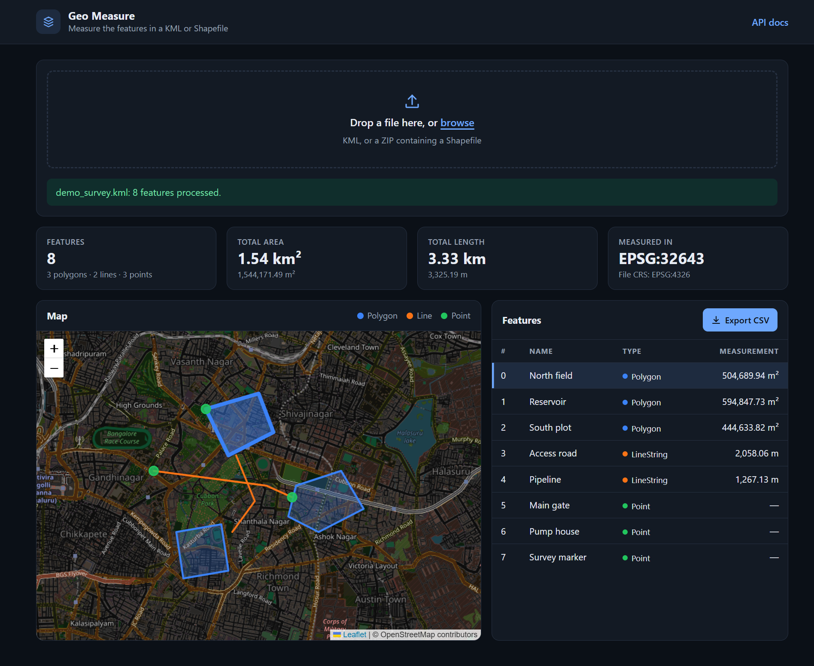

# Geospatial File Measurement API


A backend service that accepts a geospatial file (a zipped **Shapefile** or a **KML**), extracts every feature, and returns **area** (polygons) and **length** (lines) measurements in metric units.

Built with **FastAPI**, **GeoPandas / Shapely / PyProj**, and **SQLite (SQLAlchemy)**. Includes a small map-based demo page.

**Live demo: https://geo-measure-api-milan.onrender.com** · **API docs: https://geo-measure-api-milan.onrender.com/docs**



**Contents:** [Live demo](#live-demo) · [Features](#features) · [Getting started](#getting-started) · [Development](#development) · [API](#api) · [Architecture](#architecture) · [Design decisions](#design-decisions) · [Known limitations](#known-limitations) · [Learning and future scope](#learning-and-future-scope)

## Live demo

**https://geo-measure-api-milan.onrender.com**

Upload a KML or a zipped Shapefile on the home page (sample files are in [`sample_data/`](sample_data/), for example `demo_survey.kml`), or try the endpoints at [`/docs`](https://geo-measure-api-milan.onrender.com/docs).

Hosted on Render's free tier, so please note:

- The service sleeps after ~15 minutes of inactivity; the **first request can take about a minute** to wake it up.
- Storage is ephemeral: uploaded data and the SQLite database are wiped when the service restarts or sleeps.
- Uploads are limited to 10 MB. Please don't upload sensitive data.

## Features

- Upload a `.kml` or a `.zip` containing one or more Shapefiles
- Per-feature extraction: index, geometry type, geometry (GeoJSON), CRS and properties
- Polygon **area** (m²) and LineString **length** (m), computed in a **projected CRS** — never in degrees
- Reads **all** KML layers (folders) and all Shapefiles in a zip, and aligns their CRSs before combining
- Unsupported or missing geometries are reported with a note instead of crashing the request
- Processing status tracking (`PROCESSING` → `COMPLETED` / `FAILED`) with stored error messages
- Optional reprojection of returned geometries (`?crs=EPSG:4326`), e.g. for web maps
- CSV export of the measurements (`GET /api/files/{id}/measurements.csv`), safe to open in Excel
- Demo web page: drag-and-drop upload, summary cards, map, measurements table and CSV download
- Interactive API docs at `/docs` (Swagger UI)
- Automated test suite (pytest), CI (GitHub Actions) and Docker support

## Getting started

Requires **Python 3.10+** (developed and tested on 3.12). Alternatively, use [Docker](#run-with-docker).

### Run locally

**Windows (PowerShell)**

```powershell
git clone https://github.com/milantony05/geo-measure-api.git
cd geo-measure-api
python -m venv .venv
.venv\Scripts\Activate.ps1
pip install -r requirements.txt
uvicorn app.main:app --reload
```

If PowerShell refuses to run the activation script, run this once and retry:
`Set-ExecutionPolicy -Scope CurrentUser RemoteSigned`

**macOS / Linux**

```bash
git clone https://github.com/milantony05/geo-measure-api.git
cd geo-measure-api
python3 -m venv .venv
source .venv/bin/activate
pip install -r requirements.txt
uvicorn app.main:app --reload
```

A SQLite database file (`geo.db`) is created automatically on first start.

### Run with Docker

```bash
docker compose up --build
```

The SQLite database is stored in a named Docker volume, so data survives restarts. Stop with `docker compose down` (add `-v` to also delete the stored data).

The container listens on the port given by the `PORT` environment variable (default `8000`), which is how cloud hosts tell an app where to listen.

### Deploy (Render)

The live demo runs on [Render](https://render.com)'s free tier as a **Docker web service** built directly from this repository, with:

- Language: Docker, instance type: Free, region: Singapore
- Health check path: `/health`
- Environment variables: `PORT=10000`, `MAX_UPLOAD_MB=10`

The same settings are captured in [`render.yaml`](render.yaml), so the service can also be created with **New + → Blueprint** and selecting this repository.

### Try it

Once the server is running (locally at http://127.0.0.1:8000, with Docker at http://localhost:8000, or at the [live demo](#live-demo)):

| URL | What it is |
|---|---|
| `/` | **Demo page**: upload a file, see features on a map and in a table, export CSV |
| `/docs` | Interactive API documentation (Swagger UI) |
| `/health` | Health check |

**Sample files** are in `sample_data/` (regenerate them with `python scripts/make_samples.py` and `python scripts/make_demo_kml.py`):

| File | Contents |
|---|---|
| `demo_survey.kml` | A richer demo: 3 polygons, 2 lines and 3 points near Bengaluru |
| `sample.kml` | A polygon, a line and a point near Bengaluru (EPSG:4326) |
| `sample_shapefile.zip` | Two polygons, stored in EPSG:4326 |
| `sample_shapefile_utm.zip` | The same polygons stored in EPSG:32643 (UTM, metres) — shows that reprojection puts them in the right place on the map |

### Web demo

The demo page lets you drag and drop a KML or zipped Shapefile to see summary statistics, the features on a map (Leaflet + OpenStreetMap) and a table of measurements. Click a table row (or a shape on the map) to select it, and use **Export CSV** to download the measurements. The page supports light and dark mode and works on narrow screens.

It is intentionally a single static page (plain HTML/CSS/JS, no build step) served by FastAPI, and it only uses the public API (`POST /api/files/`, `GET /api/files/{id}/measurements/?crs=EPSG:4326` and the CSV endpoint). Leaflet is loaded from a CDN, so the map needs an internet connection. User-controlled text (feature names, properties) is inserted with `textContent`, never as HTML.

## Development

### Run the tests

```bash
pytest -v
```

### Continuous integration

GitHub Actions (`.github/workflows/ci.yml`) runs the test suite on every push and pull request, then builds the Docker image and smoke-tests the container's `/health` endpoint.

### Configuration (optional environment variables)

| Variable | Default | Meaning |
|---|---|---|
| `DATABASE_URL` | `sqlite:///./geo.db` (Docker image: `sqlite:////data/geo.db`) | SQLAlchemy database URL |
| `MAX_UPLOAD_MB` | `50` | Maximum accepted upload size |
| `PORT` | `8000` | Port the container listens on (Docker only) |

## API

On Windows PowerShell, use `curl.exe` instead of `curl` in the examples below (`curl` is an alias for a different command there). The examples use a local server; replace `http://127.0.0.1:8000` with the live demo URL to try them there.

### `POST /api/files/` — upload and process a file

Accepts `multipart/form-data` with a `file` field (`.kml`, or `.zip` containing one or more Shapefiles).

```bash
curl -F "file=@sample_data/sample.kml" http://127.0.0.1:8000/api/files/
```

Response `201 Created`:

```json
{
  "id": "152c4053293640c999fb62c6cd52cfeb",
  "filename": "sample.kml",
  "feature_count": 3,
  "crs": "EPSG:4326",
  "status": "COMPLETED",
  "error": null,
  "created_at": "2026-10-12T12:01:12.281170"
}
```

### `GET /api/files/{id}/` — file information

```bash
curl http://127.0.0.1:8000/api/files/152c4053293640c999fb62c6cd52cfeb/
```

Returns the same object as the upload response (`200 OK`).

### `GET /api/files/{id}/measurements/` — per-feature measurements

```bash
curl http://127.0.0.1:8000/api/files/152c4053293640c999fb62c6cd52cfeb/measurements/
```

Response `200 OK` (shortened to two features; `properties` trimmed):

```json
{
  "id": "152c4053293640c999fb62c6cd52cfeb",
  "filename": "sample.kml",
  "crs": "EPSG:4326",
  "projected_crs": "EPSG:32643",
  "feature_count": 3,
  "features": [
    {
      "feature_index": 0,
      "geometry_type": "Polygon",
      "geometry": {
        "type": "Polygon",
        "coordinates": [[[77.59, 12.97], [77.6, 12.97], [77.6, 12.98], [77.59, 12.98], [77.59, 12.97]]]
      },
      "crs": "EPSG:4326",
      "properties": { "Name": "Plot A", "description": "A square polygon" },
      "measurement": { "type": "area", "value": 1201683.919, "unit": "m2" },
      "note": null
    },
    {
      "feature_index": 2,
      "geometry_type": "Point",
      "geometry": { "type": "Point", "coordinates": [77.595, 12.975] },
      "crs": "EPSG:4326",
      "properties": { "Name": "Gate C" },
      "measurement": null,
      "note": null
    }
  ]
}
```

- `crs` (top level) is the CRS of the uploaded file; `projected_crs` is the metric CRS the measurements were computed in.
- Each feature's `geometry` is GeoJSON, and its `crs` field describes those coordinates.
- `measurement` is `null` for points and for unsupported geometries; `note` explains why when relevant.
- When a file contains several layers or Shapefiles, each feature's `properties` also include `source_layer` (the KML folder or Shapefile name).

**Optional query parameter `crs`**: return geometries reprojected to another CRS, e.g. `?crs=EPSG:4326`. Useful for web maps, which expect longitude/latitude. Without it, geometries are returned in the file's original CRS. Measurements are never affected (they are always computed in a projected, metric CRS). An unknown CRS returns `400`.

```bash
curl "http://127.0.0.1:8000/api/files/<id>/measurements/?crs=EPSG:4326"
```

### `GET /api/files/{id}/measurements.csv` — export as CSV

```bash
curl -OJ http://127.0.0.1:8000/api/files/<id>/measurements.csv
```

Downloads one row per feature with the columns `feature_index, name, geometry_type, measurement_type, measurement_value, measurement_unit, source_layer, note`. The file is UTF-8 with a byte-order mark so Excel displays non-English names correctly. Text values that start with `=`, `+`, `-` or `@` are prefixed with `'` to prevent spreadsheet formula injection. Returns `404` / `409` like the measurements endpoint.

### Error responses

| Status | When |
|---|---|
| `400` | Unsupported file extension, empty file, or an unknown `crs` query value |
| `404` | Unknown file id |
| `409` | Measurements (or CSV) requested for a file that is not `COMPLETED` |
| `413` | Upload larger than `MAX_UPLOAD_MB` |
| `422` | File could not be read (corrupt zip, no `.shp`, missing CRS, malformed KML). The failure is stored: `detail.file_id` can be used with `GET /api/files/{id}/` to see `status: FAILED` and the error message |
| `500` | Unexpected server error (also recorded as `FAILED`) |

## Architecture

### Application structure

```
app/
├── main.py            # FastAPI app: startup (creates tables), routers, demo page
├── config.py          # Settings (upload size limit)
├── db.py              # SQLAlchemy engine / session
├── models.py          # Tables: files, features
├── schemas.py         # Pydantic response models
├── crud.py            # Database operations
├── api/
│   └── files.py       # HTTP endpoints (thin — no geospatial logic)
├── services/
│   ├── errors.py      # GeoFileError, ReprojectionError
│   ├── reader.py      # KML / zipped Shapefiles -> one GeoDataFrame
│   ├── crs.py         # Projected CRS selection
│   ├── measure.py     # Feature extraction + measurements
│   ├── reproject.py   # GeoJSON reprojection for the ?crs= parameter
│   └── export.py      # CSV export (with formula-injection protection)
└── static/            # Demo page (index.html, app.js, style.css)
tests/                 # pytest: service-level and API-level tests
scripts/               # Sample data generators and exploration helpers
sample_data/           # Example KML / Shapefile inputs
docs/                  # README screenshot
Dockerfile, docker-compose.yml, render.yaml
.github/workflows/ci.yml
```

The API layer only handles HTTP concerns (validation, status codes). All geospatial logic lives in `services/`, so it can be tested without a web server.

### File-processing flow

1. **Validate the request**: extension must be `.kml` or `.zip`; the body must be non-empty and within the size limit.
2. **Save** the upload to a temporary directory under a fixed name (the user-supplied filename is never used as a path).
3. **Create** a `files` row with status `PROCESSING`.
4. **Read** the file with GeoPandas. KML: every layer (folder) is read. Zip: safe extraction (zip-slip and size checks), then every `.shp` is read.
5. **Combine and validate**: empty layers are skipped, a CRS must be defined, and there must be at least one feature. If sources use different CRSs they are reprojected to the first one's. When there is more than one source, each feature gets a `source_layer` property. Z values are dropped.
6. **Measure** every feature (see below).
7. **Store** all features and set the status to `COMPLETED` in a **single transaction**.
8. On failure the row is set to `FAILED` with an error message, and the API responds with the matching status code.
9. The temporary directory is deleted automatically.

### Measurement calculation flow

1. Choose one projected CRS for the whole file (see CRS handling).
2. Reproject a **copy** of the geometries into that CRS (units: metres).
3. For each feature:
   - `Polygon` / `MultiPolygon` → `area` in m²
   - `LineString` / `MultiLineString` → `length` in m
   - `Point` / `MultiPoint` → no measurement
   - anything else, or an empty geometry → no measurement and an explanatory `note`
   - invalid geometries (e.g. self-intersecting polygons) are measured but flagged in `note`
4. Return the **original, un-projected** geometry alongside the measurement (or reprojected to the CRS requested with `?crs=`).

### CRS handling

- KML is always WGS 84 (EPSG:4326). Shapefiles carry their CRS in the `.prj` file.
- Degrees are never used for measurement (1° of longitude shrinks towards the poles).
- The UTM zone that best fits the data is chosen with `GeoDataFrame.estimate_utm_crs()` (for example, Bengaluru → EPSG:32643). Data in any input CRS (geographic or projected) is first reprojected to that UTM zone.
- The projected copy is used only to calculate. By default responses contain the user's original coordinates and CRS; with `?crs=` they are reprojected on request, using `always_xy=True` so coordinates stay in (longitude, latitude) order.

## Design decisions

| Decision | Choice | Alternatives considered / reasoning |
|---|---|---|
| Framework | **FastAPI** | Django + DRF would add ORM/admin/settings boilerplate that this small, API-only service doesn't need. FastAPI gives typed request/response models and automatic OpenAPI docs. |
| Projected CRS | **Best-fit UTM zone per file** | An equal-area projection (e.g. Albers / Mollweide) is better for very large extents; a geodesic calculation (`pyproj.Geod`) has no zone distortion at all. UTM is metric, standard, and accurate for survey-scale data. I cross-checked against geodesic results: for the sample data they differ by ~0.12%, which is expected projection distortion. |
| Files without a CRS | **Rejected (422)** | Assuming EPSG:4326 could silently produce wrong measurements for data that is actually in a projected CRS. |
| Original vs projected geometry in responses | **Original by default, `?crs=` on request** | GeoJSON consumers expect lon/lat, and the projection used for measuring is an internal detail that differs per file. Letting the server reproject on request means clients (like the demo page) need no GIS library. |
| Unsupported geometries | **Reported with a `note`** | Failing the whole upload because of one feature would make files unusable. |
| Multiple layers / shapefiles | **Combine all, tag with `source_layer`** | Reading only the first layer would silently drop data. Mixed CRSs are aligned before merging. `source_layer` appears only when there are several sources, so simple files keep clean output. |
| CSV export | **Server-side endpoint** | Keeps the export part of the public API (scriptable with `curl`, testable) instead of being browser-only. User-supplied text is neutralised against spreadsheet formula injection, and the file carries a UTF-8 BOM so Excel reads it correctly. |
| Processing model | **Synchronous, with status lifecycle** | Fine for typical survey files. The `PROCESSING/COMPLETED/FAILED` status and stored errors make it straightforward to move to a background worker later. |
| Storage | **SQLite + SQLAlchemy; geometry as GeoJSON in a JSON column** | PostgreSQL/PostGIS would enable spatial queries but adds setup friction, and this service never queries spatially. `DATABASE_URL` makes switching databases easy. |
| Atomic saves | **One transaction for all features + final status** | A file can never be `COMPLETED` with missing features. |
| IDs | **Random UUIDs** | Sequential ids are guessable. |
| Security | Zip-slip and zip-bomb checks, upload size limit, temp directory, no user-supplied paths, no HTML injection in the UI | Uploaded archives and the text inside them are untrusted input. |
| Endpoint style | **Plain `def` endpoints** | GeoPandas is blocking and CPU-bound; FastAPI runs sync endpoints in a thread pool so the event loop is not blocked. |
| Frontend | **One static page, no framework** | The task is a backend service; a build-less page keeps the demo easy to run and fully reviewable, and exercises the public API like any other client. |
| Hosting | **Docker on Render's free tier** | The same image that runs locally and in CI is what is deployed. The free tier needs no payment details, at the cost of cold starts and ephemeral storage (see limitations). The container reads `PORT` so it works on any host. |

## Known limitations

- One UTM zone is used per file, so measurements for files spanning several zones are less accurate.
- `created_at` is returned without a timezone suffix because SQLite does not store timezones.
- Processing is synchronous; very large files will hold the request open.
- Reprojecting output with `?crs=` requires the file's CRS to be identifiable (e.g. an EPSG code); custom CRS definitions without an authority code cannot be reprojected.
- Tables are created with `create_all` (no migrations), so a schema change requires recreating the database.
- The demo page renders every feature; very large files (thousands of features) will be slow in the browser.
- The hosted demo runs on a free tier with ephemeral storage, so data does not survive restarts or sleep, and old file ids will return `404`.
- There is no rate limiting or authentication, which a public deployment would need.

## Learning and future scope

### What I learned

- I learned why geospatial measurements cannot be calculated directly from latitude and longitude in degrees, and how using a suitable projected CRS such as UTM allows areas and lengths to be calculated in metres. I also learned why the original coordinates should be preserved in the API response.
- I learned how to build a file-processing API using FastAPI, GeoPandas and Shapely, from validating KML and zipped Shapefile uploads to extracting individual features and returning their measurements as structured JSON.
- I learned the importance of handling errors and tracking processing status. Instead of treating every failure the same way, the API uses appropriate HTTP status codes and records whether processing completed or failed, along with the error message.
- I gained a better understanding of file-upload security, including upload size limits, safe ZIP extraction, protection against path traversal attacks (zip-slip), and avoiding the use of user-supplied filenames as filesystem paths.
- I learned to separate API endpoints from geospatial processing logic and database operations, making the application easier to test and maintain. I also learned the importance of database transactions to prevent a file from being marked as completed when its features have not all been stored successfully.
- With more time, I would explore background processing for large uploads, and compare projected measurements with geodesic calculations across datasets covering larger geographical areas.

### Future scope

- Background processing (Celery/RQ + Redis) with polling or webhooks
- PostgreSQL + PostGIS for spatial queries, with Alembic migrations
- Authentication, rate limiting and per-user file ownership
- Pagination and filtering on the measurements endpoint
- GeoJSON and GeoPackage upload support
- Geodesic measurement option
- Bundle Leaflet locally (with integrity checks) and rebuild the demo in React/TypeScript