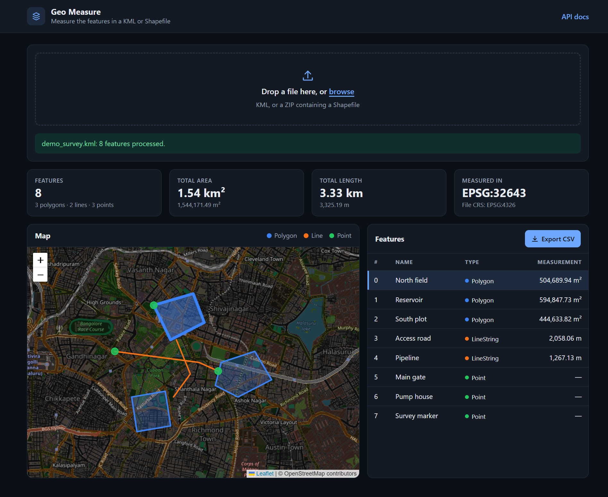

# Geospatial File Measurement API

Upload a KML file or a zipped Shapefile and get back the area, perimeter and length of every feature, measured accurately in a metric projection. Comes with a small web demo, a CSV export and an interactive API docs page.

**Live demo:** https://geo-measure-api-milan.onrender.com

> The demo runs on a free tier. If it has been idle for a while, the first load can take up to a minute.



## Features

- Upload `.kml` or zipped Shapefile (`.zip`) files
- Reads every layer in a KML and every `.shp` in a zip
- Measures in the best-fit UTM zone for the data, so results are in real metres rather than degrees
- Returns the original geometry by default, or reprojects it with `?crs=EPSG:xxxx`
- Stores results in a database with a status (`PROCESSING`, `COMPLETED`, `FAILED`)
- Export results as CSV
- Browser demo with a map, table and summary cards

## Tech stack

FastAPI, GeoPandas, Shapely, PyProj, pyogrio, SQLAlchemy (SQLite), pytest, Docker, GitHub Actions, Leaflet.

## API

| Method | Endpoint | Description |
|---|---|---|
| `POST` | `/api/files/` | Upload a file (multipart field `file`). Returns the file record with its `id` |
| `GET` | `/api/files/{id}/` | Processing status and file details |
| `GET` | `/api/files/{id}/measurements/` | Measurements per feature. Optional `?crs=EPSG:4326` to reproject geometry |
| `GET` | `/api/files/{id}/measurements.csv` | Same measurements as a CSV download |
| `GET` | `/health` | Health check |

Example:

```bash
curl -F "file=@sample_data/demo_survey.kml" https://geo-measure-api-milan.onrender.com/api/files/
```

Full request and response schemas are on the `/docs` page.

## Run locally

Requires Python 3.12.

```powershell
git clone https://github.com/milantony05/geo-measure-api.git
cd geo-measure-api
python -m venv venv
venv\Scripts\activate
pip install -r requirements.txt
uvicorn app.main:app --reload
```

Open http://127.0.0.1:8000 for the demo page or http://127.0.0.1:8000/docs for the API docs.

### With Docker

```bash
docker compose up --build
```

### Tests

```bash
pytest
```

Sample files to try are in `sample_data/`.

## Configuration

| Variable | Default | Purpose |
|---|---|---|
| `DATABASE_URL` | `sqlite:///./geo.db` | Database connection string |
| `MAX_UPLOAD_MB` | `50` | Maximum upload size |
| `PORT` | `8000` | Port used by the Docker container |

## Project structure

```
app/
  api/files.py      # HTTP endpoints
  services/         # reading, CRS selection, measuring, reprojection, CSV export
  models.py         # database tables
  crud.py           # database operations
  static/           # demo frontend (HTML, CSS, JS)
tests/              # 36 tests
scripts/            # sample data generators
Dockerfile, docker-compose.yml, render.yaml
```

## Design decisions

- **Measure in UTM, return the original geometry.** Area and length computed in degrees are meaningless, so each file is measured in its best-fit UTM zone, while the geometry you get back stays in its original CRS unless you ask otherwise.
- **Status lifecycle.** Each upload is recorded as `PROCESSING` and ends as `COMPLETED` or `FAILED` with an error message. Results are saved in a single transaction, so a file never ends up half-saved.
- **Safe uploads.** Size limit, zip-slip and zip-bomb checks, and temporary directories that are cleaned up after processing.
- **Safe output.** The frontend uses `textContent` to avoid XSS, and the CSV export neutralises spreadsheet formula injection.
- **SQLite.** Simple and zero-setup for this scope. Switching databases only needs a different `DATABASE_URL` and a driver.

## Known limitations

- Free hosting: the service sleeps when idle, and the disk is ephemeral, so stored results can disappear on restart.
- Uploads are processed within the request. Very large files would need a background job queue.
- Only KML and zipped Shapefile are supported.

## Future work

- Background processing with a task queue
- More formats (GeoJSON, GeoPackage)
- Persistent hosted database and authentication
